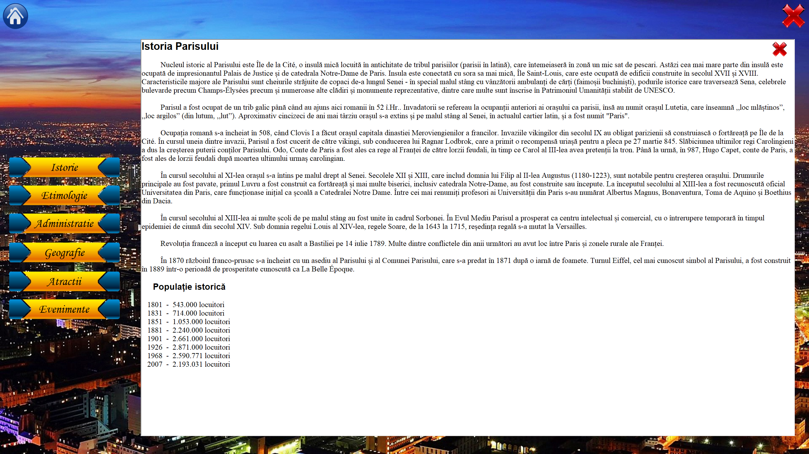
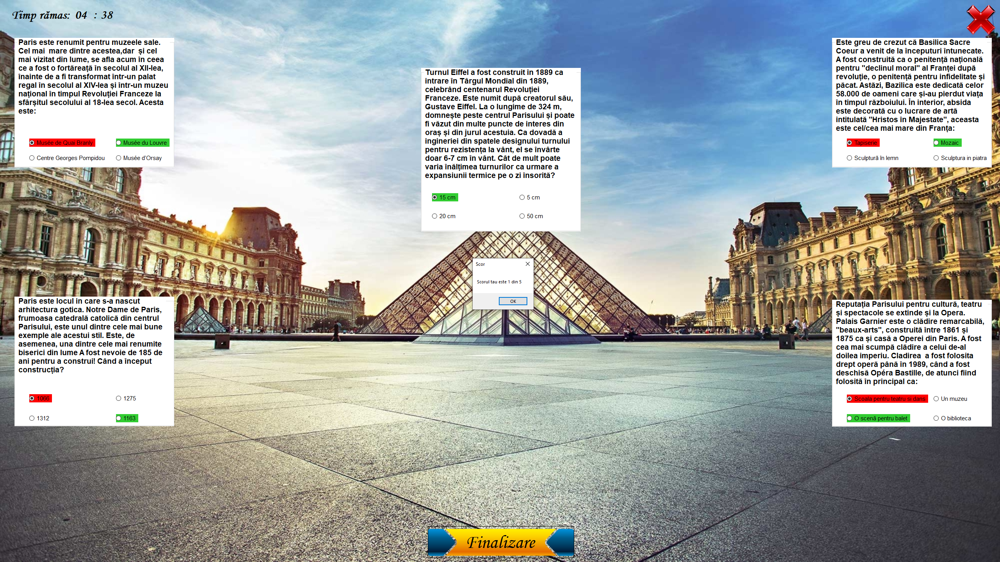
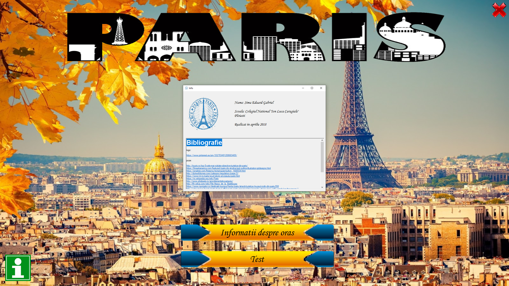

# Paris WinForms Application

A simple Windows Forms (.NET Framework) desktop application in C# that presents information about Paris covering history, etymology, administration, geography and historical events, alongside a carousel of attractions, followed by a fixed 5-question quiz based on the content.

The project was developed in 2018.

## Overview

The application is organized around informational screens, an interactive showcase of attractions and historical events, and a 5-question knowledge check:

- **General Information:** Covers Paris across history, etymology, administration, and geography.
- **Attractions & Historical Events Carousel:** Displays attractions and historical milestones for browsing.
- **Knowledge Quiz:** Provides a fixed set of 5 questions covering topics presented in the informational sections.


## Project Structure

```text
screenshots/
Paris.sln
└── Paris/
    ├── Paris.csproj
    ├── App.config
    ├── Program.cs
    ├── logo.ico
    ├── Form1.cs / Form1.Designer.cs / Form1.resx
    ├── Informatii.cs / Informatii.Designer.cs / Informatii.resx
    ├── Atractii.cs / Atractii.Designer.cs / Atractii.resx
    ├── Info.cs / Info.Designer.cs / Info.resx
    ├── Test.cs / Test.Designer.cs / Test.resx
    ├── Properties/
    └── Resurse/
```

## Prerequisites

- OS: Windows
- IDE / Build Tool: Visual Studio, .NET Framework 4.5.2


## Build and Run

1. Clone the repository and open `Paris.sln` in Visual Studio.
2. Select the desired build configuration (Debug or Release) from the toolbar.
3. Build the solution using `Ctrl + Shift + B` or `Build > Build Solution`.
4. Run the application from Visual Studio (F5 or Ctrl + F5) or launch `Paris\bin\Debug\Paris.exe` (or `Paris\bin\Release\Paris.exe`).


## Screenshots





